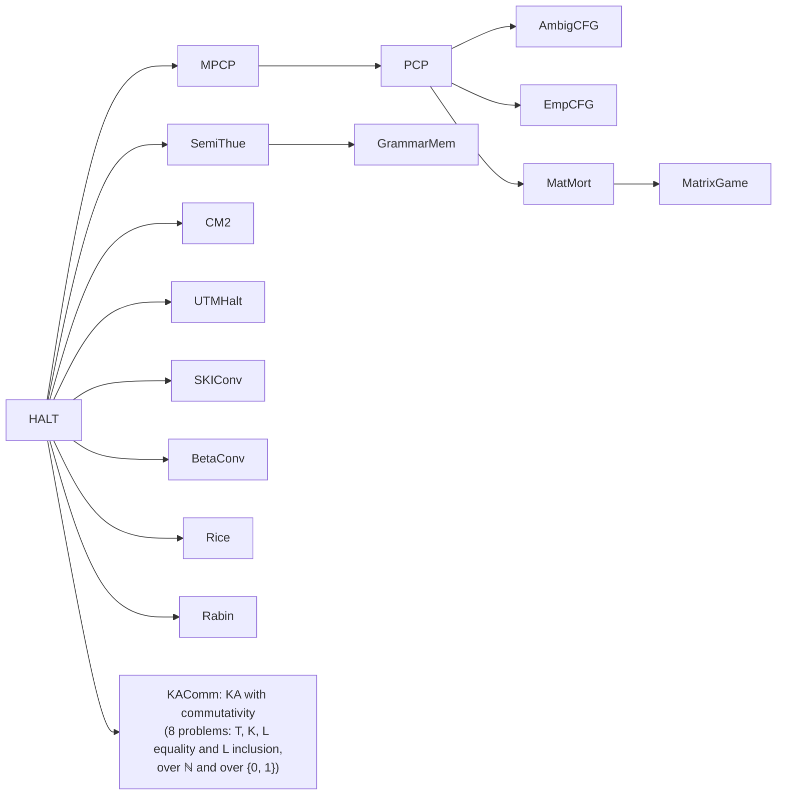

# ⊢ DiagonaLean

A Lean 4 library of machine-checked undecidability results, built on [Mathlib](https://github.com/leanprover-community/mathlib4) and [Cslib](https://github.com/leanprover/cslib).

## About

Most undecidability proofs in textbooks and papers are a chain of reductions: halting reduces to problem A, A reduces to B, and so on. Each step is a construction that is easy to get slightly wrong and hard to check by eye. DiagonaLean formalises these chains in Lean 4. Each problem gets an exact definition, each reduction gets a correctness proof, and each undecidability result says exactly what it means.

The project has three goals:

* **A library of undecidable problems.** Each problem is stated once, and the reductions to it are proved correct. The classical problems from automata theory are covered, and so are results from current research, such as the undecidability of Kleene algebra with commutativity conditions (arXiv:2411.15979).
* **Honest statements.** Lean's logic is classical, so a naive statement of undecidability can be proved by a case split on whether a machine halts. The library rules this out in two ways, described in [Two notions of undecidability](#two-notions-of-undecidability).
* **Tactics for reductions.** Composing reductions and reusing the reduction graph should take one line. `reduce_from` composes a halting reduction with a link, in either layer; `reduce_from_pcp` and `code_lift` handle the PCP source and the alphabet lift. `undec from P` finds and composes reductions through a named source problem. `undec?` displays a route from halting as a script that names each reduction.

DiagonaLean continues <https://github.com/aalok-thakkar/undecidability/>.

## Formalisations So Far

Every reduction starts from the halting problem for single-tape Turing machines over `{0, 1}`. Its undecidability is proved by diagonalisation, which gives the library its name.



| Problem | Question | Folder | Proved |
|---|---|---|---|
| Halting | Does Turing machine $M$ halt on input $w$? | [`Halt/`](DiagonaLean/Halt/README.md) | `¬ MachineDecidable` (`halt_not_machinedecidable`); no machine decides it or self-halting (`halt_undecidable`, `self_halt_undecidable`) |
| Universal machine halting | For a fixed weakly universal machine $U$, does $U$ halt on $w$? | [`UTMHalt/`](DiagonaLean/UTMHalt/README.md) | No machine decides it (`not_exists_haltDeciderFor_of_isWeaklyUniversal`) |
| Modified PCP | Given tiles and a designated start tile, is there a match that begins with it? | [`MPCP/`](DiagonaLean/MPCP/README.md) | `SynthHaltReduction`, `¬ ComputablePred`, `¬ MachineDecidable` under every computable encoding, over any alphabet with at least two letters |
| Post Correspondence Problem | Given tiles $(u_i, v_i)$, is there a nonempty sequence with $u_{i_1}\cdots u_{i_n} = v_{i_1}\cdots v_{i_n}$? | [`PCP/`](DiagonaLean/PCP/README.md) | `SynthHaltReduction`, `¬ ComputablePred`, `¬ MachineDecidable` under every computable encoding, over any alphabet with at least two letters |
| String rewriting (semi-Thue) | Given rewriting rules `l → r` between strings, does `u` rewrite to `v`? | [`SemiThue/`](DiagonaLean/SemiThue/README.md) | `SynthHaltReduction`, `¬ ComputablePred`, `¬ MachineDecidable` under every computable encoding, over any alphabet with at least two letters |
| Membership for grammar codes | Given a grammar code and a word, is the word in its language? | [`GrammarMem/`](DiagonaLean/GrammarMem/README.md) | `SynthHaltReduction`; `¬ ComputablePred` and `¬ MachineDecidable` under every computable encoding, and for the empty word already over type 0 codes |
| Ambiguity of CFGs | Does a context-free grammar have two parse trees for some word? | [`AmbigCFG/`](DiagonaLean/AmbigCFG/README.md) | `SynthHaltReduction`; for grammar codes, `¬ ComputablePred` and `¬ MachineDecidable` under every computable encoding |
| Intersection of CFGs | Do the languages of two context-free grammars intersect? (Emptiness of the intersection is the complement.) | [`EmpCFG/`](DiagonaLean/EmpCFG/README.md) | `SynthHaltReduction` over any alphabet with at least two letters; for grammar codes, `¬ ComputablePred` and `¬ MachineDecidable` under every computable encoding, for the intersection and for its emptiness |
| Matrix mortality | Given a finite set of $3 \times 3$ integer matrices, does some product of them equal $0$? | [`MatMort/`](DiagonaLean/MatMort/README.md) | `SynthHaltReduction`, `¬ ComputablePred`, `¬ MachineDecidable` under every computable encoding |
| SKI convertibility | Do two SKI terms have a common reduct? | [`SKIConv/`](DiagonaLean/SKIConv/README.md) | `SynthHaltReduction`, `¬ MachineDecidable` |
| β-conversion | Are two λ-terms β-convertible? | [`BetaConv/`](DiagonaLean/BetaConv/README.md) | `SynthHaltReduction`, `¬ MachineDecidable` |
| Rice's problem | For a set $C$ of partial functions $\mathbb N \rightharpoonup \mathbb N$, does a program compute a function in $C$? | [`Rice/`](DiagonaLean/Rice/README.md) | `¬ ComputablePred` and `¬ MachineDecidable` for every non-trivial $C$; `SynthHaltReduction` when $C$ contains some computable function but not the nowhere-defined one; of the complement when $C$ contains the nowhere-defined function and misses some computable function |
| Rabin's game | Given a finite program for a primitive recursive payoff $g$, in a language with an instruction that runs a bounded Turing-machine simulation, can Player I win the game where I picks $i$, II picks $j$, I picks $k$, and I wins iff $g(k) = i + j$? | [`Rabin/`](DiagonaLean/Rabin/README.md) | `SynthHaltReduction`, `¬ ComputablePred`, `¬ MachineDecidable` under every computable encoding |
| Matrix game | Given finite sets of $3 \times 3$ integer matrices for Eve and Adam, who alternately right-multiply starting from the identity, can Eve force the product to $0$? | [`MatrixGame/`](DiagonaLean/MatrixGame/README.md) | `SynthHaltReduction`, `¬ ComputablePred`, `¬ MachineDecidable` under every computable encoding, already when Adam plays $\pm I$ |
| Two-counter machine halting | Given a program of increments and conditional decrements on two counters with values in $\mathbb N$, does the machine halt from zero counters? | [`CM2/`](DiagonaLean/CM2/README.md) | `SynthHaltReduction`, `HaltReduction`, `¬ ComputablePred`, `¬ MachineDecidable` under every computable encoding |
| Kleene algebra with commutativity | Is $e = f$ provable in Kleene algebra (`KATermEq`) or pre-Kleene algebra (`TermEq`) with commutativity conditions on letters? Is $\mathcal L(e) = \mathcal L(f)$ (`LangEq`), or $\mathcal L(e) \subseteq \mathcal L(f)$ (`ModelLe`), in the language model? Each over $\Sigma = \mathbb N$ and over $\Sigma = \{0, 1\}$ (`XBool`). | [`KAComm/`](DiagonaLean/KAComm/README.md) | `SynthHaltReduction` (for `LangEq`, `ModelLe`: of the complement), `¬ MachineDecidable`; also `¬ MachineDecidable` for every theory between pre-Kleene algebra and the language model (Theorem 18) |

The Kleene algebra folder formalises A. Azevedo de Amorim, C. Zhang and M. Gaboardi, *Kleene algebra with commutativity conditions is undecidable* (arXiv:2411.15979). Its main results hold with no hypotheses. It also finds and repairs an error in the paper's Theorem 6. Its [README](DiagonaLean/KAComm/README.md) states the results mathematically and explains how to audit them, and [STATUS.md](DiagonaLean/KAComm/STATUS.md) records what is open.

The Rabin folder also proves Rabin's theorem (`rabin_game`): for one primitive recursive payoff, Player II has a winning strategy, but every computable strategy for Player II loses on some play.

Shared machinery lives in `Foundations/`:

* the computability infrastructure (`Foundations/Computability/`): a Turing-machine interpreter for Mathlib's partial recursive codes, machines computing primitive recursive functions, and a race between a halting search and a proof search, following Smullyan;
* proof search for combinatory logic and the λ-calculus (`Foundations/CombinatoryLogic/`, `Foundations/LambdaCalculus/`);
* grammars presented by lists, and grammar codes (`Foundations/Grammar/`): a `Primcodable` description of a context-free grammar, which a machine can read, and the theorem that renaming nonterminals keeps the language; string rewriting systems, which every grammar of the Chomsky hierarchy is, with derivability checked by a stack machine uniformly in the system;
* codes between alphabets (`Foundations/Codes/`): letterwise codes, the problems that they preserve and reflect (PCP, MPCP, string rewriting, context-free grammars) as functors on codes, and the lifting of `SynthHaltReduction`, `¬ ComputablePred` and `¬ MachineDecidable` from one alphabet to every alphabet with two letters (`code_lift`);
* the normalisation of Turing machines (`Foundations/Computability/Normalize/`): every machine over `{0, 1}` is equivalent, for halting, to one that never writes a blank and never moves left at the left end, as the reductions to MPCP, PCP and string rewriting assume;
* proof systems checked by a stack machine (`Foundations/Computability/StackProof.lean`): running proof programs, the invariant, and the primitive recursive check, once for every system. SKI convertibility and string rewriting are instances.

`Synthetic/` holds the definitions of reductions and undecidability, and the reduction check.

## Two Notions of Undecidability

Lean is classical, so every proposition is "decidable" in the sense of `Classical.propDecidable`. Undecidability therefore has to be stated relative to some notion of computation. The library uses two: `SynthHaltReduction p` and `¬ MachineDecidable enc p`. In the table above, a problem lists each notion that is proved for it.

### 1. `SynthHaltReduction p`: a compiled many-one reduction from halting

```lean
-- simplified from Synthetic/Definitions.lean and Synthetic/HaltReduction.lean
structure SynthReduction (p : X → Prop) (q : Y → Prop) where
  f  : X → Y
  hf : ∀ x, p x ↔ q (f x)          -- written p ⪯_s[f] q

abbrev SynthHaltReduction (p : X → Prop) : Type := HaltProblem ⪯_s p
```

`SynthHaltReduction p` is a **type**, not a proposition. An undecidability result is a **definition** whose value is the reduction, and composing results composes their functions (`SynthHaltReduction.comp`). The point is that **Lean must compile the reduction**. The cheating "reduction" `fun x => if HaltProblem x then a else b` is classical, and Lean refuses to compile it. So a result means something because it is a definition that Lean compiles. `#check_reductions` enforces this in CI over every declaration in the library. It checks that the reduction is a compiled definition, that nothing in its dependencies is `sorry`, an axiom or `native_decide`, that no reduction is wrapped in a way that hides it, and that no `Prop` statement concludes that a reduction exists. The conventions it relies on are listed in [CONTRIBUTING.md](CONTRIBUTING.md#reductions).

* *Strength:* reductions compose, and each one is visibly a program.
* *Limitation:* "Lean compiles it" is not the same as "a Turing machine computes it on encoded inputs". Also, constants that exist only classically, such as a universal program obtained from Mathlib's recursion theorem, cannot be computed inside a definition, so they become explicit arguments of the result (for example `SKIConv.synthFromHalt C hu hC`).

### 2. `¬ MachineDecidable enc P`: no Turing machine decides it

```lean
-- with TMDeciderFor unfolded
def MachineDecidable (enc : X → List Bool) (P : X → Prop) : Prop :=
  ∃ D : SingleTapeTM Bool, ∀ x,
    (P x → D.Outputs (enc x) [true]) ∧ (¬ P x → D.Outputs (enc x) [false])
```

This statement quantifies over actual Turing machines (Cslib's `SingleTapeTM`) running on an encoding `enc` of the instances as bit strings, so it cannot hold vacuously. It is a plain theorem with no parameters, so constants that exist only classically are no obstacle. There are four ways to prove it:

* from a reduction that a machine computes on encodings: `ComputesReduction R enc₁ enc₂ f` together with `not_machineDecidable_of_halt_reduces`;
* from a race between halting and a proof search (`Foundations/Computability/ProofRace.lean`);
* from the computably inseparable pair "outputs 1 on its own code" and "outputs 0 on its own code" (`Halt/Inseparable.lean`);
* from Mathlib's `¬ ComputablePred P`, for any computable encoding (`not_machineDecidable_of_not_computablePred` in `Foundations/Computability/MachineBridge.lean`). For an encoding with a computable decoder, `MachineDecidable enc P ↔ ComputablePred P` (`machineDecidable_iff`).

* *Strength:* this is the textbook statement, and it is unconditional.
* *Limitation:* it is relative to the encoding. An encoding that stores the answer in its first bit makes any predicate decidable. So the library's reference encodings are proved injective, and the Kleene algebra results come with `_of_conv` variants that hold for any encoding a machine computes from the reference one.

### Which to read
For trust, read the `¬ MachineDecidable` theorem and the definitions it uses (see the [audit guide](DiagonaLean/KAComm/README.md#auditing-the-definitions)). For composing results and building the reduction graph, use `SynthHaltReduction`.

## How to Use It

### Build
You need [elan](https://github.com/leanprover/elan). The toolchain is pinned in `lean-toolchain` (Lean `v4.35.0`).

```sh
git clone https://github.com/DiagonaLean/DiagonaLean
cd DiagonaLean
lake exe cache get   # download prebuilt Mathlib
lake build
```

### Depend on it
In your project's `lakefile.toml`:

```toml
[[require]]
name = "DiagonaLean"
git = "https://github.com/DiagonaLean/DiagonaLean"
rev = "main"
```

### Prove a new problem undecidable
Reduce from a problem that is already undecidable, and give the reduction as a named definition:

```lean
import DiagonaLean

open DiagonaLean DiagonaLean.Synthetic.Definitions DiagonaLean.PCP

/-- A toy problem: PCP with the two rows of every tile swapped. -/
def SwappedPCP (A : Stack Bool) : Prop := DecisionProblem (A.map fun t => ⟨t.bot, t.top⟩)

/-- The reduction function: swap the rows of every tile. -/
def swap (A : Stack Bool) : Stack Bool := A.map fun t => ⟨t.bot, t.top⟩

/-- Correctness of the reduction. -/
theorem swap_spec : (@DecisionProblem Bool) ⪯_s[swap] SwappedPCP := fun A => by
  simp [SwappedPCP, swap, List.map_map, Function.comp_def]

/-- The reduction, as data: a link from PCP. -/
@[undecReduction] def SwappedPCP.synthFromPCP : (@DecisionProblem Bool) ⪯_s SwappedPCP := ⟨swap, swap_spec⟩

/-- `SwappedPCP` is synthetically halting-hard: PCP's halting reduction, then the link. -/
def SwappedPCP.synthFromHalt : SynthHaltReduction SwappedPCP := by
  reduce_from (PCP.synthFromHaltOver true false (by decide)) via SwappedPCP.synthFromPCP

#check_reductions local              -- checks the definitions in this file
#print axioms SwappedPCP.synthFromHalt  -- propext, Classical.choice, Quot.sound
```

`undec from P` finds a route from halting through a named source problem `P`. The halting reduction for the matrix game, `MatrixGame.synthFromHalt`, is proved by `undec from MatMort.DecisionProblem`. Run `lake env lean examples/GameReductions.lean` to display the proof terms for both games and play through a finite example.

The proof can also start at binary PCP. Run the following after `import DiagonaLean` to see the alphabet lift to Paterson's alphabet, the reduction from PCP to mortality, and the reduction from mortality to the game.

```lean
open DiagonaLean DiagonaLean.Synthetic.Definitions

example : SynthHaltReduction MatrixGame.DecisionProblem := by
  undec? from PCP.PCProblem
```

Lean displays the route and suggests a script that names each reduction on it, here `undec from PCP.synthFromHaltBool via MatMort.synthS23FromPCP, MatMort.synthFromPCP, MatrixGame.synthFromMatMort`. The script composes exactly those reductions, so replaying it does not depend on which reductions are tagged. For a machine-level goal the same source predicate selects a registered theorem of noncomputability. The search checks the functions along each candidate route and uses the encoding hypothesis.

```lean
example {enc : MatrixGame.Arena → List Bool} (he : Computable enc) :
    ¬ Synthetic.Definitions.MachineDecidable enc MatrixGame.DecisionProblem := by
  undec? from PCP.PCProblem
```

```text
Binary PCP → PCP over Paterson’s alphabet → 3×3 matrix mortality → Matrix-game winner
Try this: undec from PCP.MachineLevel.not_computablePred_pcp via MatMort.synthS23FromPCP,
  MatMort.synthFromPCP, MatrixGame.synthFromMatMort
```

Use `undec from P` for a quiet proof and `undec? from P` to see the route and a replayable script. For synthetic goals, `undec?` also discovers a source starting from halting. Search starts with local hypotheses and tagged reductions. If they do not solve the goal, it also searches for concrete reduction definitions in the current file and its imports. Each search is breadth first. Two predicates count as the same problem when they agree after unfolding reducible and instance definitions, so a problem should be stated with `abbrev` or as a `def` used under one name. For machine-level goals it tries certified paths in both searches before leaving proof obligations. A bundled computable reduction supplies its own certificate. If only a structural route is available, each missing computability proof becomes a goal. The diagnostic names the edge or encoding that needs evidence.

Tag a source theorem of the form `¬ ComputablePred P` with `@[undecHardness]`. Type and instance arguments can be inferred from `P`, as in the PCP theorem over any nontrivial alphabet. You can also pass the source theorem directly. To display a mathematical name for a problem, supply a `Synthetic.ReductionChain.ProblemName P` instance.

A compiled definition of type `P ⪯_s Q` or `SynthHaltReduction Q` can be discovered without a tag. Machine-level goals also use definitions of type `P ⪯ Q` or `HaltReduction Q`. Use `@[undecReduction]` to give a concrete synthetic reduction priority. For a family with parameters, supply a specialized witness as a local hypothesis or a named definition. The search skips a tagged declaration that is not a closed reduction, and names it when no route is found; `scripts/CheckUndecTags.lean` fails CI on such a tag, or on an `@[undecHardness]` theorem that does not state `¬ ComputablePred P`. The [palindrome grammar example](examples/PalindromeGrammar.lean) uses an untagged PCP reduction.

### Prove a function primitive recursive, computable, or computed by a Turing machine
The tactics in `DiagonaLean.Foundations.Computability` do this one definition at a time, with one
call each:

```lean
import DiagonaLean
open DiagonaLean.Foundations.Computability

def fib : ℕ → ℕ
  | 0 => 0
  | 1 => 1
  | n + 2 => fib n + fib (n + 1)

@[fun_prop] theorem fib_primrec : Primrec fib := by primrec_rec   -- recursion
example : Primrec fun n : ℕ => fib (2 * n) + n := by fun_prop     -- composition
example : Computable fib := by fun_prop                           -- Primrec ⇒ Computable

def step (n : ℕ) (l : List ℕ) : List ℕ := if n < l.length then l else n :: l
derive_primrec step                                                -- registers `step_prim`
example : Primrec fun n : ℕ => step (fib n) [n] := by fun_prop

inductive Rose where                                               -- your own type
  | node (label : ℕ) (kids : List Rose)
derive_primcodable Rose

def Rose.total : Rose → ℕ
  | .node a cs => a + (cs.map Rose.total).sum
example : Primrec Rose.total := by primrec_rec
```

and `tm_computer F` gives a `SingleTapeTM Bool` computing a function `F : List Bool → List Bool`
that `fun_prop` proves computable. [`examples/Automation.lean`](examples/Automation.lean) is a
guided tour of all of it (`lake env lean examples/Automation.lean`), and
[`AUTOMATION.md`](DiagonaLean/Foundations/Computability/AUTOMATION.md) explains how it works.

### Tactics and commands
DiagonaLean defines these. Each one produces an ordinary proof or definition that the kernel
checks.

**Reductions and undecidability**

| Tactic or command | What it does | Defined in |
|---|---|---|
| `reduce_from_pcp over_letters b0 b1 via R` | Proves `SynthHaltReduction Q` from a reduction `R : PCP ⪯_s Q`, over the alphabet of the letters `b0 ≠ b1` | [`Synthetic/Tactics/ReduceFromPCP.lean`](DiagonaLean/Synthetic/Tactics/ReduceFromPCP.lean) |
| `reduce_from h via r` | Composes a halting reduction `h` with a link `r`; the goal (`SynthHaltReduction Q`, `HaltReduction Q`, `HaltHard Q`, `¬ ComputablePred Q`, `¬ MachineDecidable enc Q`) decides whether the result is synthetic or proved, and a synthetic link is upgraded when its computability can be proved | [`Foundations/Computability/ReduceFrom.lean`](DiagonaLean/Foundations/Computability/ReduceFrom.lean) |
| `undec from P` / `undec?` | Finds a route through the source predicate `P`; `undec?` finds a route from halting and suggests a script that replays it | [`Synthetic/Tactics/UndecFrom.lean`](DiagonaLean/Synthetic/Tactics/UndecFrom.lean) |
| `undec from h` for `h : ¬ ComputablePred P` | Transfers noncomputability or machine undecidability along computable reductions | [`Foundations/Computability/UndecTransfer.lean`](DiagonaLean/Foundations/Computability/UndecTransfer.lean) |
| `reduction_path` | Composes a shortest chain of reductions for a goal `P ⪯_s Q` | [`Synthetic/Tactics/ReductionPath.lean`](DiagonaLean/Synthetic/Tactics/ReductionPath.lean) |
| `undec from H` / `undec from H via?` | Reduces `SynthHaltReduction Q` to a reduction `P ⪯_s Q`, given `H : SynthHaltReduction P`. Append `via?` to search for that reduction | [`Synthetic/Tactics/UndecFrom.lean`](DiagonaLean/Synthetic/Tactics/UndecFrom.lean) |
| `undec from H via r₁, …, rₙ` | Composes the source `H` (a halting reduction, a predicate, or a proof of `¬ ComputablePred P`) with exactly the reductions `rᵢ`, checking that each starts where the previous one ends | [`Synthetic/Tactics/UndecFrom.lean`](DiagonaLean/Synthetic/Tactics/UndecFrom.lean) |
| `#check_reductions` / `#check_reductions local` | Checks that every reduction (in the library, or in the current file) is a definition Lean compiles, with no classical escape hatch | [`Synthetic/ReductionCheck.lean`](DiagonaLean/Synthetic/ReductionCheck.lean) |

For example, the last definition in *Prove a new problem undecidable* above can be written

```lean
def swappedUndecidable : SynthHaltReduction SwappedPCP := by
  reduce_from_pcp over_letters true false via pcpReducesSwapped
```

**Computability**

| Tactic or command | What it does | Defined in |
|---|---|---|
| `fun_prop` (set up for `Primrec`, `PrimrecPred`, `Computable`) | Proves that a function built by composition is primitive recursive or computable; a function out of a finite type, or a `match` on one, needs no lemma | [`Foundations/Computability/Prim.lean`](DiagonaLean/Foundations/Computability/Prim.lean) |
| `derive_primrec f` | States, proves (`unfold f; fun_prop`) and registers the `fun_prop` lemma `f_prim` of a non-recursive definition, after which `fun_prop` handles `f` applied to any primitive recursive arguments | [`Foundations/Computability/DerivePrimrec.lean`](DiagonaLean/Foundations/Computability/DerivePrimrec.lean) |
| `primrec_rec` | Proves `Primrec f` or `Primrec₂ f` for `f` defined by recursion on `ℕ`, lists, or a type from `derive_primcodable`, read off `f`'s equations | [`Foundations/Computability/PrimrecRec.lean`](DiagonaLean/Foundations/Computability/PrimrecRec.lean) |
| `derive_primcodable T` | Makes an inductive type `Primcodable`, with `fun_prop` lemmas for its constructors and the recursion principle `primrec_rec` uses; nested `List T` and `Option T` fields and universe-polymorphic types are supported | [`Foundations/Computability/DerivePrimcodable.lean`](DiagonaLean/Foundations/Computability/DerivePrimcodable.lean) |
| `tm_computer F` | Proves `∃ R : SingleTapeTM Bool, ∀ l, R.Outputs l (F l)` for `F : List Bool → List Bool` that `fun_prop` proves computable | [`Foundations/Computability/Computer.lean`](DiagonaLean/Foundations/Computability/Computer.lean) |
| `tm_computes F` | Reduces `∃ R, ComputesReduction R enc₁ enc₂ f` to the equation `F (enc₁ x) = enc₂ (f x)`, for the `¬ MachineDecidable` results | [`Foundations/Computability/Computer.lean`](DiagonaLean/Foundations/Computability/Computer.lean) |

[`examples/Automation.lean`](examples/Automation.lean) shows the computability tactics at work.

### Inspect a result
`#check @name` shows a statement with all its binders, and `#print axioms name` lists what it depends on. A sound result lists only `propext`, `Classical.choice` and `Quot.sound`. For example:

```lean
#check @DiagonaLean.KAComm.KATermEqBool.Reduction.not_machineDecidable_kaTermEqBool
-- ¬ MachineDecidable encBool KATermEqBoolProblem
```

### Contribute
Read [CONTRIBUTING.md](CONTRIBUTING.md) first. It covers:

* the commit conventions;
* the folder layout: each problem `X` has `Basic.lean` (the problem), `Reductions/Y_to_X.lean` (the reductions) and `Undecidable.lean` (the results), and where they apply `MachineLevel.lean` (the results about machines) and `AlphabetLift.lean` (the lifting to other alphabets); problems from one larger result are subfolders of a shared folder, as in `KAComm/`; and `Foundations/` may depend only on `Foundations`, `Synthetic` and `Halt`;
* the conventions for reductions that `#check_reductions` relies on.

CI runs `lake build`, `lake lint`, `#check_reductions`, `scripts/CheckMetaprograms.lean` (no metaprogram that edits the environment) with its tests in `scripts/CheckMetaprogramsTest.lean`, `scripts/FunPropTest.lean`, and `scripts/CheckLayering.lean`.

## Roadmap

* **Core framework:** the problems above, `SynthHaltReduction` and `MachineDecidable`, the reduction check, and the `reduce_from_pcp` tactic. Done, string rewriting included (`SemiThue/`, `GrammarMem/`).
* **Base theorems:** Rice's theorem is done (`Rice/`). Still to come: the acceptance problem, Rice–Shapiro and Greibach; a reduction graph registered through attributes, and a tactic that searches it.
* **Standard reduction library:** more models of computation (RAM machines, register machines, μ-recursive functions) and their equivalence with Turing machines, where Cslib does not already have them.
