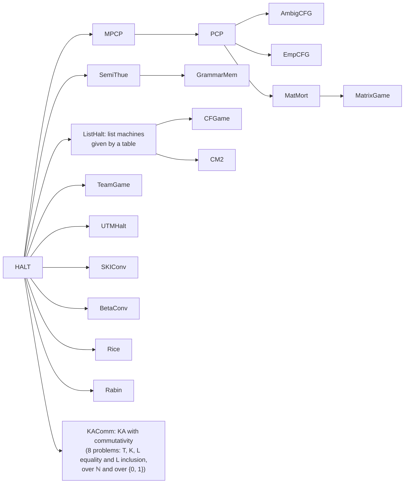

# ⊢ DiagonaLean

A Lean 4 library of machine-checked undecidability results, built on [Mathlib](https://github.com/leanprover-community/mathlib4) and [Cslib](https://github.com/leanprover/cslib).

## About

Most undecidability proofs in textbooks and papers are a chain of reductions: halting reduces to problem A, A reduces to B, and so on. Each step is a construction that is easy to get slightly wrong and hard to check by eye. DiagonaLean formalises these chains in Lean 4. Each problem gets an exact definition, each reduction gets a correctness proof, and each undecidability result says exactly what it means.

The project has three goals:

* **A library of undecidable problems.** Each problem is stated once, and the reductions to it are proved correct. The classical problems from automata theory are covered, and so are results from current research, such as the undecidability of Kleene algebra with commutativity conditions (arXiv:2411.15979).
* **Honest statements.** Lean's logic is classical, so a naive statement of undecidability can be proved by a case split on whether a machine halts. The library rules this out in two ways, described in [Two notions of undecidability](#two-notions-of-undecidability).
* **Tactics for reductions.** Composing reductions and reusing the reduction graph should take one line. A reduction is written as its function and its correctness proof (`synth_reduce_from h with f using spec`, `hard_reduce_from h with f using spec`), with no bundled link, and several links chain in one call separated by commas; `reduce_from` composes with an existing link in either layer; `upgrade` turns a synthetic halting reduction into a proved one, cut at the last problem with a proved reduction, leaving one `Computable` goal per remaining link; `reduce_from_pcp` and `code_lift` handle the PCP source and the alphabet lift; `halt_results` states the consequences of a proved halting reduction under uniform names. `undec from P` finds and composes reductions through a named source problem, and `undec?` displays a route from halting as a script that names each reduction.

DiagonaLean continues <https://github.com/aalok-thakkar/undecidability/>.

## Formalisations So Far

Every reduction starts from the halting problem for single-tape Turing machines over `{0, 1}`. Its undecidability is proved by diagonalisation, which gives the library its name.



| Problem | Question | Folder | Proved |
|---|---|---|---|
| Halting | Does Turing machine $M$ halt on input $w$? | [`Halt/`](DiagonaLean/Halt/README.md) | `¬ MachineDecidable` (`halt_not_machinedecidable`); no machine decides it or self-halting (`halt_undecidable`, `self_halt_undecidable`) |
| Universal machine halting | For a fixed weakly universal machine $U$, does $U$ halt on $w$? | [`UTMHalt/`](DiagonaLean/UTMHalt/README.md) | No machine decides it (`not_exists_haltDeciderFor_of_isWeaklyUniversal`) |
| Modified PCP | Given tiles and a designated start tile, is there a match that begins with it? | [`MPCP/`](DiagonaLean/MPCP/README.md) | `SynthHaltReduction`, `HaltHard`, `¬ ComputablePred`, `¬ MachineDecidable` under every computable encoding, over any alphabet with at least two letters (`MPCP.haltHard`, …); recursively enumerable (`MPCP.rePred`) |
| Post Correspondence Problem | Given tiles $(u_i, v_i)$, is there a nonempty sequence with $u_{i_1}\cdots u_{i_n} = v_{i_1}\cdots v_{i_n}$? | [`PCP/`](DiagonaLean/PCP/README.md) | `SynthHaltReduction`, `HaltHard`, `¬ ComputablePred`, `¬ MachineDecidable` under every computable encoding, over any alphabet with at least two letters (`PCP.haltHard`, …); recursively enumerable (`PCP.rePred`) |
| String rewriting (semi-Thue) | Given rewriting rules `l ⟶ r` between words, does `u` rewrite to `v` (`u ↠[R] v`)? | [`SemiThue/`](DiagonaLean/SemiThue/README.md) | `SynthHaltReduction`, `HaltHard`, `¬ ComputablePred`, `¬ MachineDecidable` under every computable encoding, over any alphabet with at least two letters (`SemiThue.haltHard`, …); the same for systems with non-empty left sides (`SemiThue.Pos.haltHard`, …); recursively enumerable (`SemiThue.rePred`) |
| Membership for grammar codes | Given a grammar code and a word, is the word in its language? | [`GrammarMem/`](DiagonaLean/GrammarMem/README.md) | `SynthHaltReduction`; `HaltHard`, `¬ ComputablePred` and `¬ MachineDecidable` under every computable encoding (`GrammarMem.haltHard`, …), and for the empty word already over type 0 codes (`GrammarMem.EmptyWord.haltHard`, …); recursively enumerable (`GrammarMem.rePred`, `GrammarMem.EmptyWord.rePred`) |
| Ambiguity of CFGs | Does a context-free grammar have two parse trees for some word? | [`AmbigCFG/`](DiagonaLean/AmbigCFG/README.md) | `SynthHaltReduction`; for grammar codes over any alphabet with at least two letters, `HaltHard`, `¬ ComputablePred` and `¬ MachineDecidable` under every computable encoding (`AmbigCFG.Code.haltHard`, …) |
| Intersection of CFGs | Do the languages of two context-free grammars intersect? (Emptiness of the intersection is the complement.) | [`EmpCFG/`](DiagonaLean/EmpCFG/README.md) | `SynthHaltReduction` over any alphabet with at least two letters; for grammar codes over any alphabet with at least two letters, `HaltHard`, `¬ ComputablePred` and `¬ MachineDecidable` under every computable encoding (`EmpCFG.Code.haltHard`, …), and recursively enumerable (`EmpCFG.Code.rePred`); `¬ ComputablePred` and `¬ MachineDecidable` for its emptiness |
| Matrix mortality | Given a finite set of $3 \times 3$ integer matrices, does some product of them equal $0$? | [`MatMort/`](DiagonaLean/MatMort/README.md) | `SynthHaltReduction`, `HaltHard`, `¬ ComputablePred`, `¬ MachineDecidable` under every computable encoding (`MatMort.haltHard`, …); recursively enumerable (`MatMort.rePred`) |
| SKI convertibility | Do two SKI terms have a common reduct? | [`SKIConv/`](DiagonaLean/SKIConv/README.md) | `SynthHaltReduction`, `HaltHard`, `¬ ComputablePred`, `¬ MachineDecidable` under every computable encoding (`SKIConv.haltHard`, …); recursively enumerable (`SKIConv.rePred`) |
| β-conversion | Are two λ-terms β-convertible? | [`BetaConv/`](DiagonaLean/BetaConv/README.md) | `SynthHaltReduction`, `HaltHard`, `¬ ComputablePred`, `¬ MachineDecidable` under every computable encoding (`BetaConv.haltHard`, …); recursively enumerable (`BetaConv.rePred`) |
| Rice's problem | For a set $C$ of partial functions $\mathbb N \rightharpoonup \mathbb N$, does a program compute a function in $C$? | [`Rice/`](DiagonaLean/Rice/README.md) | `¬ ComputablePred` and `¬ MachineDecidable` for every non-trivial $C$; `SynthHaltReduction` when $C$ contains some computable function but not the nowhere-defined one; of the complement when $C$ contains the nowhere-defined function and misses some computable function (`Rice.not_computablePred`, `Rice.not_machineDecidable`) |
| Rabin's game | Given a finite program for a primitive recursive payoff $g$, in a language with an instruction that runs a bounded Turing-machine simulation, can Player I win the game where I picks $i$, II picks $j$, I picks $k$, and I wins iff $g(k) = i + j$? | [`Rabin/`](DiagonaLean/Rabin/README.md) | `SynthHaltReduction`, `¬ ComputablePred`, `¬ MachineDecidable` under every computable encoding (`Rabin.not_computablePred`, `Rabin.not_machineDecidable`) |
| Matrix game | Given finite sets of $3 \times 3$ integer matrices for Eve and Adam, who alternately right-multiply starting from the identity, can Eve force the product to $0$? | [`MatrixGame/`](DiagonaLean/MatrixGame/README.md) | `SynthHaltReduction`, `HaltHard`, `¬ ComputablePred`, `¬ MachineDecidable` under every computable encoding (`MatrixGame.haltHard`, …), already when Adam plays $\pm I$ |
| Active context-free games | Given rules $A \to u$ ($u$ non-empty) and a regular target, Juliet picks a non-terminal in the word and Romeo rewrites it by a rule; can Juliet force the word into the target? | [`CFGame/`](DiagonaLean/CFGame/README.md) | `SynthHaltReduction`, `HaltHard`, `¬ ComputablePred`, `¬ MachineDecidable` under every computable encoding for the combined problem (game and word), with letters in ℕ (`CFGame.haltHard`, …) |
| Team games with imperfect information | Two players with private observations play against Nature on a finite graph; do they have strategies so that every play reaches a target (reachability), or avoids bad positions (safety)? | [`TeamGame/`](DiagonaLean/TeamGame/README.md) | `SynthHaltReduction` for reachability, and for the complement of safety |
| Two-counter machine halting | Given a two-counter Minsky machine (instructions: increment a counter and go to a state; go to one state if a counter is zero, otherwise decrement it and go to another), does it halt from zero counters? | [`CM2/`](DiagonaLean/CM2/README.md) | `SynthHaltReduction`, `HaltHard`, `¬ ComputablePred`, `¬ MachineDecidable` under every computable encoding (`CM2.haltHard`, …); recursively enumerable (`CM2.rePred`) |
| Kleene algebra with commutativity | Is $e = f$ provable in Kleene algebra (`KATermEq`) or pre-Kleene algebra (`TermEq`) with commutativity conditions on letters? Is $\mathcal L(e) = \mathcal L(f)$ (`LangEq`), or $\mathcal L(e) \subseteq \mathcal L(f)$ (`ModelLe`), in the language model? Each over $\Sigma = \mathbb N$ and over $\Sigma = \{0, 1\}$ (`XBool`). | [`KAComm/`](DiagonaLean/KAComm/README.md) | `HaltHard` and recursively enumerable for `KATermEq`, `TermEq` and their `XBool` forms (`KAComm.KATermEq.haltHard`, `KAComm.KATermEq.rePred`, …); `SynthHaltReduction` (for `LangEq`, `ModelLe`: of the complement); `¬ ComputablePred` and `¬ MachineDecidable` under every computable encoding for all eight (`KAComm.X.not_computablePred`, `KAComm.X.not_machineDecidable`); also `¬ MachineDecidable` for every theory between pre-Kleene algebra and the language model (Theorem 18) |

The Kleene algebra folder formalises A. Azevedo de Amorim, C. Zhang and M. Gaboardi, *Kleene algebra with commutativity conditions is undecidable* (arXiv:2411.15979). Its main results hold with no hypotheses. It also finds and repairs an error in the paper's Theorem 6. Its [README](DiagonaLean/KAComm/README.md) states the results mathematically and explains how to audit them, and [STATUS.md](DiagonaLean/KAComm/STATUS.md) records what is open.

The Rabin folder also proves Rabin's theorem (`rabin_game`): for one primitive recursive payoff, Player II has a winning strategy, but every computable strategy for Player II loses on some play.

Shared machinery lives in `Foundations/`:

* the computability infrastructure (`Foundations/Computability/`): a Turing-machine interpreter for Mathlib's partial recursive codes, machines computing primitive recursive functions, and a race between a halting search and a proof search, following Smullyan;
* string rewriting systems (`Foundations/Rewriting/SRS.lean`): words, rules with a left and a right side, one rewriting step `u ⭢[R] v` and derivability `u ↠[R] v`, in a file of definitions only;
* convertibility of SKI terms and β-convertibility of λ-terms (`Foundations/CombinatoryLogic/Conv.lean`, `Foundations/LambdaCalculus/Conv.lean`, definitions only), and proof search for both (`ProofSearch.lean` in the same folders);
* grammars presented by lists, and grammar codes (`Foundations/Grammar/`): a `Primcodable` description of a context-free grammar, which a machine can read, and the theorem that renaming nonterminals keeps the language; context-free grammar codes as string rewriting systems (`ToSRS.lean`), since every grammar of the Chomsky hierarchy is one, with derivability checked by a stack machine uniformly in the system (`Rewriting.lean`);
* codes between alphabets (`Foundations/Codes/`): letterwise codes, the problems that they preserve and reflect (PCP, MPCP, string rewriting, context-free grammars) as functors on codes, and the lifting of `SynthHaltReduction`, `¬ ComputablePred` and `¬ MachineDecidable` from one alphabet to every alphabet with two letters (`code_lift`);
* the normalisation of Turing machines (`Foundations/Computability/Normalize/`): every machine over `{0, 1}` is equivalent, for halting, to one that never writes a blank and never moves left at the left end, as the reductions to MPCP, PCP and string rewriting assume;
* proof systems checked by a stack machine (`Foundations/Computability/StackProof.lean`): running proof programs, the invariant, and the primitive recursive check, once for every system. SKI convertibility and string rewriting are instances;
* halting of list machines given by a table (`Foundations/Computability/ListHalt.lean`): a halting-hard source for reductions that simulate a machine, so that such a reduction is one function on tables with one correctness proof (`ListHalt.fromHalt`; `CM2/` uses it).

`Synthetic/` holds the definitions of reductions and undecidability, and the reduction check.

**Degrees.** The halting problem is complete for the recursively enumerable problems: every r.e. predicate many-one reduces to it, computably (`manyOneReducible_haltCanon_of_rePred`, `Foundations/Computability/HaltComplete.lean`). Its proof needs a machine that halts *exactly* when a program converges; the compiler from Mathlib's program codes to Cslib machines (`exists_machine`) now proves both directions, the converse through a lemma that forward simulations with progress reflect halting (`Foundations/Computability/Simulation.lean`). So a problem that is halting-hard and recursively enumerable has the degree of the halting problem, and any two such problems are many-one equivalent. The three rewriting problems are the first instances: string rewriting, SKI convertibility and β-conversion are many-one equivalent (`Degrees/Rewriting.lean`), although no translation of one rewriting system into another is a reduction (the translation of SKI terms into λ-terms does not reflect convertibility, `tr_not_reflect`).

## Two Notions of Undecidability

Lean is classical, so every proposition is "decidable" in the sense of `Classical.propDecidable`. Undecidability therefore has to be stated relative to some notion of computation. The library uses two: `SynthHaltReduction p` and `¬ MachineDecidable enc p`, with a proved layer between them, `HaltHard p` (section 3), from which `¬ ComputablePred p` and `¬ MachineDecidable enc p` follow. In the table above, a problem lists each notion that is proved for it.

`Undecidable p` (`Foundations/Computability/Undecidable.lean`) names Mathlib's `¬ ComputablePred p`, so the results `X.not_computablePred : Undecidable X.DecisionProblem` say what they mean. Unfolded, it says that no computable Boolean function decides `p` (`undecidable_iff`); without the condition `Computable`, such a function would exist for every `p`, classically.

### 1. `SynthHaltReduction p`: a compiled many-one reduction from halting

```lean
-- simplified from Synthetic/Definitions.lean and Synthetic/HaltReduction.lean
structure SynthReduction (p : X → Prop) (q : Y → Prop) where
  f  : X → Y
  hf : ∀ x, p x ↔ q (f x)          -- written p ⪯_s[f] q

abbrev SynthHaltReduction (p : X → Prop) : Type := HaltProblem ⪯_s p
```

`SynthHaltReduction p` is a **type**, not a proposition. An undecidability result is a **definition** whose value is the reduction, and composing results composes their functions (`SynthHaltReduction.comp`). The point is that **Lean must compile the reduction**. The cheating "reduction" `fun x => if HaltProblem x then a else b` is classical, and Lean refuses to compile it. So a result means something because it is a definition that Lean compiles. `#check_reductions` enforces this in CI over every declaration in the library. It checks that the reduction is a compiled definition, that nothing in its dependencies is `sorry`, an axiom or `native_decide`, that no reduction is wrapped in a way that hides it, that no `Prop` statement concludes that a reduction exists, that the encodings a problem is stated over are programs too, and that no new syntax shadows an existing parser. A second check, `scripts/CheckAxioms.lean`, requires every declaration of the library to depend only on `propext`, `Classical.choice` and `Quot.sound`, so an `axiom` or a `sorry` cannot enter the proved layer either. The conventions it relies on are listed in [CONTRIBUTING.md](CONTRIBUTING.md#reductions).

* *Strength:* reductions compose, and each one is visibly a program.
* *Limitation:* "Lean compiles it" is not the same as "a Turing machine computes it on encoded inputs". Also, constants that exist only classically, such as a universal program obtained from Mathlib's recursion theorem, cannot be computed inside a definition, so they become explicit arguments of the result (for example `SKIConv.synthFromHalt C hu hC`). `HaltHard` is a proposition, so its proofs obtain them instead (`SKIConv.haltHard`).

### 2. `¬ MachineDecidable enc P`: no Turing machine decides it

```lean
-- with TMDeciderFor unfolded
def MachineDecidable (enc : X → List Bool) (P : X → Prop) : Prop :=
  ∃ D : SingleTapeTM Bool, ∀ x,
    (P x → D.Outputs (enc x) [true]) ∧ (¬ P x → D.Outputs (enc x) [false])
```

This statement quantifies over actual Turing machines (Cslib's `SingleTapeTM`) running on an encoding `enc` of the instances as bit strings, so it cannot hold vacuously. It is a plain theorem with no parameters, so constants that exist only classically are no obstacle. There are four ways to prove it:

* from a reduction that a machine computes on encodings: `ComputesReduction R enc₁ enc₂ f` together with `not_machineDecidable_of_halt_reduces`;
* from a race between halting and a proof search (`Foundations/Computability/ProofRace.lean`);
* from the computably inseparable pair "outputs 1 on its own code" and "outputs 0 on its own code" (`Halt/Inseparable.lean`);
* from Mathlib's `¬ ComputablePred P`, for any computable encoding (`not_machineDecidable_of_not_computablePred` in `Foundations/Computability/MachineBridge.lean`). For an encoding with a computable decoder, `MachineDecidable enc P ↔ ComputablePred P` (`machineDecidable_iff`).

* *Strength:* this is the textbook statement, and it is unconditional.
* *Limitation:* it is relative to the encoding. An encoding that stores the answer in its first bit makes any predicate decidable. So the library's reference encodings are proved injective, and the Kleene algebra results come with `_of_conv` variants that hold for any encoding a machine computes from the reference one.

### 3. `HaltHard p`: a reduction from halting, proved computable

```lean
-- from Foundations/Computability/HaltCanon.lean
abbrev HaltReduction (P : β → Prop) := HaltCanon ⪯ P          -- Computable f, checked by the kernel
abbrev HaltHard (P : β → Prop) : Prop := Nonempty (HaltReduction P)
```

`HaltCanon` is halting for canonical machines (states `Fin n`), which, unlike `HaltProblem`, is
`Primcodable`, so the computability of a reduction from it can be stated and proved. `HaltHard p`
is a proposition with content: Mathlib's many-one reducibility from halting (`haltHard_iff`). It
gives `Undecidable p` (that is, `¬ ComputablePred p`) and `¬ MachineDecidable enc p` for every
computable encoding. Where a problem has a `HaltReduction`, or a proof of `HaltHard` when the
reduction needs constants that exist only classically, `halt_results` states all three as
`X.haltHard`, `X.not_computablePred` and `X.not_machineDecidable`.

* *Strength:* the strongest of the three statements, under Mathlib's notion of computability.
* *Limitation:* it needs a `Primcodable` type of instances, so problems on Mathlib's grammars are
  stated on grammar codes, and a reduction from `HaltProblem` has to be rebuilt from `HaltCanon`
  rather than upgraded.

### Which to read
For trust, read the `¬ MachineDecidable` theorem and the definitions it uses (see the [audit guide](DiagonaLean/KAComm/README.md#auditing-the-definitions), and [How problems are defined](#how-problems-are-defined)). For composing results and building the reduction graph, use `SynthHaltReduction`.

## How Problems Are Defined

A result is only as trustworthy as the definition of its problem, so every `X/Basic.lean` is written to be read without opening any other file of the library. The rewriting problems (string rewriting, SKI convertibility, β-conversion) follow four layers:

| layer | rule | string rewriting |
|---|---|---|
| object | plain data with named fields, `Primcodable` | `Word T := List T`, a rule `⟨lhs, rhs⟩`, a system `SRS T` (a list of rules) |
| step | an inductive relation, one constructor per textbook rule | `p ++ l ++ q ⭢[R] p ++ r ++ q` for a rule `l ⟶ r` of `R` |
| closure | Mathlib's or Cslib's closure, never a new one | `u ↠[R] v` is `ReflTransGen` of a step |
| question | a curried statement, and the one-argument form the tactics need | `WordProblem R u v`; `DecisionProblem (R, u, v)` |

Each problem then states what it means in upstream terms, by `Iff.rfl`, so the kernel checks the explanation:

```lean
theorem SemiThue.decisionProblem_mk (R : SRS T) (u v : Word T) :
    DecisionProblem (R, u, v) ↔ WordProblem R u v := Iff.rfl
theorem SemiThue.wordProblem_iff (R : SRS T) (u v : Word T) :
    WordProblem R u v ↔ ReflTransGen (SRS.Step R) u v := Iff.rfl
theorem SKIConv.convertible_iff (x y : SKI) :
    Convertible x y ↔ ∃ z, ReflTransGen Red x z ∧ ReflTransGen Red y z := Iff.rfl
```

Problems on tuples (MPCP, the grammar problems, the Kleene algebra problems) have the same `decisionProblem_mk` to their curried form.

**To audit a problem**, read its curried definition and these `Iff.rfl` statements, which the kernel checks against the definition, rather than the one-line `DecisionProblem` on instances that the tactics use. Every `Basic.lean` names them in its header. Results are always stated on the one-argument problem: a partially applied curried problem would type-check as a different, weaker claim. The relations themselves live in files of definitions only (`Foundations/Rewriting/SRS.lean`, `Foundations/CombinatoryLogic/Conv.lean`, `Foundations/LambdaCalculus/Conv.lean`), apart from the machinery that proves things about them, so a `Basic.lean` imports a few dozen lines rather than a proof search. `scripts/HeadlineTest.lean` pins these statements next to the headline results, so a change to what a problem means fails CI.

## How to Use It

### Build
You need [elan](https://github.com/leanprover/elan). The toolchain is pinned in `lean-toolchain` (Lean `v4.35.0`).

```sh
git clone https://github.com/DiagonaLean/DiagonaLean
cd DiagonaLean
lake exe cache get   # download prebuilt Mathlib
lake build
```

### Depend on it
In your project's `lakefile.toml`:

```toml
[[require]]
name = "DiagonaLean"
git = "https://github.com/DiagonaLean/DiagonaLean"
rev = "main"
```

### Prove a new problem undecidable
Reduce from a problem that is already undecidable: give the reduction function and its correctness,
and the tactics build the results. No bundled link is needed.

```lean
import DiagonaLean

open DiagonaLean DiagonaLean.Synthetic.Definitions DiagonaLean.Foundations.Computability
  DiagonaLean.PCP

/-- A toy problem: PCP with the two rows of every tile swapped. -/
def SwappedPCP (A : Stack Bool) : Prop := DecisionProblem (A.map fun t => ⟨t.bot, t.top⟩)

/-- The reduction function: swap the rows of every tile. -/
def swap (A : Stack Bool) : Stack Bool := A.map fun t => ⟨t.bot, t.top⟩

/-- Correctness of the reduction. -/
theorem swap_spec : (@DecisionProblem Bool) ⪯_s[swap] SwappedPCP := fun A => by
  simp [SwappedPCP, swap, List.map_map, Function.comp_def]

/-- Computability of the reduction, for the proved layer. -/
@[fun_prop] theorem swap_primrec : Primrec swap := by
  unfold swap; fun_prop

/-- `SwappedPCP` is synthetically halting-hard: PCP's synthetic halting reduction, then `swap`. -/
def SwappedPCP.synthFromHalt : SynthHaltReduction SwappedPCP := by
  reduce_from_pcp over_letters true false with swap using swap_spec

/-- `SwappedPCP` is halting-hard: PCP's proved halting reduction, then `swap`, proved computable. -/
def SwappedPCP.fromHalt : HaltReduction SwappedPCP := by
  hard_reduce_from PCP.fromHaltBool with swap using swap_spec

namespace SwappedPCP
halt_results SwappedPCP from fromHalt   -- haltHard, not_computablePred, not_machineDecidable
end SwappedPCP

#check_reductions local                         -- checks the definitions in this file
#print axioms SwappedPCP.not_machineDecidable   -- propext, Classical.choice, Quot.sound
```

`with swap` alone leaves the two directions as goals `forward` and `backward`; `with swap unfold`
also unfolds both problems; `using fwd bwd` closes them with two lemmas.

`undec from P` finds a route from halting through a named source problem `P`, and `undec? from P` prints that route as a `reduce_from … via …` script. Library proofs are written with the script, not the search, so that they do not depend on what is imported (the `search` rule of `scripts/CheckMetaprograms.lean`): the halting reduction for the matrix game, `MatrixGame.synthFromHalt`, is the route `undec? from MatMort.DecisionProblem` finds, `reduce_from MatMort.synthFromHalt via synthFromMatMort`. The search tactics are for finding routes, in examples and tests. Run `lake env lean examples/GameReductions.lean` to display the proof terms for both games and play through a finite example.

The proof can also start at binary PCP. Run the following after `import DiagonaLean` to see the alphabet lift to Paterson's alphabet, the reduction from PCP to mortality, and the reduction from mortality to the game.

```lean
open DiagonaLean DiagonaLean.Synthetic.Definitions

example : SynthHaltReduction MatrixGame.DecisionProblem := by
  undec? from PCP.PCProblem
```

Lean displays the route and suggests a script that names each reduction on it, here `reduce_from PCP.synthFromHaltBool via MatMort.synthS23FromPCP, via MatMort.synthFromPCP, via MatrixGame.synthFromMatMort`. The script is written with `reduce_from`, the tactic library proofs use (`undec from H via r₁, …, rₙ` does the same); it composes exactly those reductions, so replaying it does not depend on which reductions are tagged. For a machine-level goal the same source predicate selects a registered theorem of noncomputability. The search checks the functions along each candidate route and uses the encoding hypothesis.

```lean
example {enc : MatrixGame.Arena → List Bool} (he : Computable enc) :
    ¬ Synthetic.Definitions.MachineDecidable enc MatrixGame.DecisionProblem := by
  undec? from PCP.PCProblem
```

```text
Binary PCP → PCP over Paterson’s alphabet → 3×3 matrix mortality → Matrix-game winner
Try this: reduce_from PCP.not_computablePred via MatMort.synthS23FromPCP,
    via MatMort.synthFromPCP, via MatrixGame.synthFromMatMort
```

Use `undec from P` for a quiet proof and `undec? from P` to see the route and a replayable script. For synthetic goals, `undec?` also discovers a source starting from halting. Search starts with local hypotheses and tagged reductions. If they do not solve the goal, it also searches for concrete reduction definitions in the current file and its imports. Each search is breadth first. Two predicates count as the same problem when they agree after unfolding reducible and instance definitions, so a problem should be stated with `abbrev` or as a `def` used under one name. For machine-level goals it tries certified paths in both searches before leaving proof obligations. A bundled computable reduction supplies its own certificate. If only a structural route is available, each missing computability proof becomes a goal. The diagnostic names the edge or encoding that needs evidence.

Tag a source theorem of the form `¬ ComputablePred P` with `@[undecHardness]`. Type and instance arguments can be inferred from `P`, as in the PCP theorem over any nontrivial alphabet. You can also pass the source theorem directly. To display a mathematical name for a problem, supply a `Synthetic.ReductionChain.ProblemName P` instance.

A compiled definition of type `P ⪯_s Q` or `SynthHaltReduction Q` can be discovered without a tag. Machine-level goals also use definitions of type `P ⪯ Q` or `HaltReduction Q`. Use `@[undecReduction]` to give a concrete synthetic reduction priority. For a family with parameters, supply a specialized witness as a local hypothesis or a named definition. The search skips a tagged declaration that is not a closed reduction, and names it when no route is found; `scripts/CheckUndecTags.lean` fails CI on such a tag, or on an `@[undecHardness]` theorem that does not state `¬ ComputablePred P`. The [palindrome grammar example](examples/PalindromeGrammar.lean) uses an untagged PCP reduction.

### Prove a function primitive recursive, computable, or computed by a Turing machine
The tactics in `DiagonaLean.Foundations.Computability` do this one definition at a time, with one
call each:

```lean
import DiagonaLean
open DiagonaLean.Foundations.Computability

def fib : ℕ → ℕ
  | 0 => 0
  | 1 => 1
  | n + 2 => fib n + fib (n + 1)

@[fun_prop] theorem fib_primrec : Primrec fib := by primrec_rec   -- recursion
example : Primrec fun n : ℕ => fib (2 * n) + n := by fun_prop     -- composition
example : Computable fib := by fun_prop                           -- Primrec ⇒ Computable

def step (n : ℕ) (l : List ℕ) : List ℕ := if n < l.length then l else n :: l
derive_primrec step                                                -- registers `step_prim`
example : Primrec fun n : ℕ => step (fib n) [n] := by fun_prop

inductive Rose where                                               -- your own type
  | node (label : ℕ) (kids : List Rose)
derive_primcodable Rose

def Rose.total : Rose → ℕ
  | .node a cs => a + (cs.map Rose.total).sum
example : Primrec Rose.total := by primrec_rec
```

and `tm_computer F` gives a `SingleTapeTM Bool` computing a function `F : List Bool → List Bool`
that `fun_prop` proves computable. [`examples/Automation.lean`](examples/Automation.lean) is a
guided tour of all of it (`lake env lean examples/Automation.lean`), and
[`AUTOMATION.md`](DiagonaLean/Foundations/Computability/AUTOMATION.md) explains how it works.

### Tactics and commands
DiagonaLean defines these. Each one produces an ordinary proof or definition that the kernel
checks.

**Reductions and undecidability**

| Tactic or command | What it does | Defined in |
|---|---|---|
| `synth_reduce_from h with f [unfold \| using spec \| using fwd bwd]` | Proves `SynthHaltReduction Q` from a synthetic halting reduction `h` to `P` and a function `f` with `P ⪯_s[f] Q`; with no `using`, leaves `forward` and `backward`. `f` must be a compiled program, checked at tactic time. `h` may be a problem, found by the naming convention | [`Foundations/Computability/ReduceFrom.lean`](DiagonaLean/Foundations/Computability/ReduceFrom.lean) |
| `hard_reduce_from h with f …` | The same for `HaltReduction Q`, `HaltHard Q`, `¬ ComputablePred Q` and `¬ MachineDecidable enc Q`; `Computable f` is closed by `fun_prop` or left as a goal. `h` is a `HaltReduction`, `HaltHard p`, `¬ ComputablePred p`, or a problem registered with `HaltSource` / `HaltHardFact` | same |
| `hard_reduce_from h with f₁ using s₁, via r, with f₂ …` | A chain of links, separated by commas, composed in order (also `synth_reduce_from`, `reduce_from`); one `Computable` goal per function or synthetic link; every link but the last needs `using` | same |
| `upgrade s` | Proves the hard goals about `Q` from a synthetic halting reduction `s` to `Q`: cuts its chain at the last problem with a proved halting reduction and upgrades the links after it, one `Computable` goal per link | [`Foundations/Computability/Upgrade.lean`](DiagonaLean/Foundations/Computability/Upgrade.lean) |
| `reduce_from h via r` / `reduce_from h with f …` | Composes `h` with a bundled link `r`, or chooses between the two tactics above by the goal; a synthetic link is upgraded by `fun_prop` on a proved goal. `h` may be a negative result (`¬ ComputablePred p`, `Undecidable p`), or a problem: found by name on a synthetic goal, through `HaltSource` / `HaltHardFact` on a proved one | same |
| `reduce_from_pcp over_letters b0 b1 with f …` | `synth_reduce_from` from PCP over the alphabet of the letters `b0 ≠ b1` (also `via R`) | [`Synthetic/Tactics/ReduceFromPCP.lean`](DiagonaLean/Synthetic/Tactics/ReduceFromPCP.lean) |
| `code_lift F from h` | Lifts a halting reduction or `¬ ComputablePred` along a functor on codes to every alphabet with two letters | [`Foundations/Codes/Tactic.lean`](DiagonaLean/Foundations/Codes/Tactic.lean) |
| `halt_results P from r` | A command: from `r : HaltReduction P` (or `r : HaltHard P`), states `haltHard`, `not_computablePred` and `not_machineDecidable`; `over_letters` for every nontrivial alphabet, `Name for` for a second problem in one namespace. It also registers them: `@[undecHardness]` on `not_computablePred` (a source for `undec?`) and `instance : HaltHardFact P` (the problem as a source for `reduce_from`) | [`Foundations/Computability/HaltResults.lean`](DiagonaLean/Foundations/Computability/HaltResults.lean) |
| `#check_reductions` / `#check_reductions local` | Checks that every reduction (in the library, or in the current file) is a definition Lean compiles, with no classical escape hatch | [`Synthetic/ReductionCheck.lean`](DiagonaLean/Synthetic/ReductionCheck.lean) |

**Finding a route** (for exploring, not for library proofs)

| Tactic | What it does | Defined in |
|---|---|---|
| `undec? from P` / `undec?` | Searches the reduction graph, breadth first, for a route to the goal (`SynthHaltReduction Q`, `¬ ComputablePred Q`, `¬ MachineDecidable enc Q`, `HaltReduction Q`, `HaltHard Q`) through the source problem `P`, or from halting; proves the goal and prints the route as a `reduce_from h via r₁, via r₂, …` script to paste (or a term, when there is nothing to compose). Edges are closed `P ⪯_s Q` / `P ⪯ Q` definitions, `@[undecReduction]` first, then any in the imports; sources are `@[undecHardness]` theorems | [`Synthetic/Tactics/UndecFrom.lean`](DiagonaLean/Synthetic/Tactics/UndecFrom.lean), [`Foundations/Computability/UndecTransfer.lean`](DiagonaLean/Foundations/Computability/UndecTransfer.lean) |
| `undec from P` / `undec from H via?` / `reduction_path` | The same search without the suggestion; `reduction_path` composes a shortest chain for a goal `P ⪯_s Q` | same, [`Synthetic/Tactics/ReductionPath.lean`](DiagonaLean/Synthetic/Tactics/ReductionPath.lean) |
| `undec from h via r₁, …, rₙ` | Follows exactly the given route, checking that each link starts where the previous one ends; allowed in the library, like `reduce_from h via r₁, via r₂, …` | [`Synthetic/Tactics/UndecFrom.lean`](DiagonaLean/Synthetic/Tactics/UndecFrom.lean) |

The route a search finds depends on what is imported and tagged, so a library proof names its route: `scripts/CheckMetaprograms.lean` (rule `search`) rejects `undec from P`, `undec?` and `reduction_path` in library files. Use the library's tactic for every job it covers, and when one fails on a case it should cover, fix it or report the gap rather than writing around it ([`CONTRIBUTING.md`](CONTRIBUTING.md), rule 2).

**Computability**

| Tactic or command | What it does | Defined in |
|---|---|---|
| `fun_prop` (set up for `Primrec`, `PrimrecPred`, `Computable`) | Proves that a function built by composition is primitive recursive or computable; a function out of a finite type, or a `match` on one, needs no lemma | [`Foundations/Computability/Prim.lean`](DiagonaLean/Foundations/Computability/Prim.lean) |
| `derive_primrec f` | States, proves (`unfold f; fun_prop`) and registers the `fun_prop` lemma `f_prim` of a non-recursive definition, after which `fun_prop` handles `f` applied to any primitive recursive arguments | [`Foundations/Computability/DerivePrimrec.lean`](DiagonaLean/Foundations/Computability/DerivePrimrec.lean) |
| `primrec_rec` | Proves `Primrec f` or `Primrec₂ f` for `f` defined by recursion on `ℕ`, lists, or a type from `derive_primcodable`, read off `f`'s equations | [`Foundations/Computability/PrimrecRec.lean`](DiagonaLean/Foundations/Computability/PrimrecRec.lean) |
| `derive_primcodable T` | Makes an inductive type `Primcodable`, with `fun_prop` lemmas for its constructors and the recursion principle `primrec_rec` uses; nested `List T` and `Option T` fields and universe-polymorphic types are supported | [`Foundations/Computability/DerivePrimcodable.lean`](DiagonaLean/Foundations/Computability/DerivePrimcodable.lean) |
| `tm_computer F` | Proves `∃ R : SingleTapeTM Bool, ∀ l, R.Outputs l (F l)` for `F : List Bool → List Bool` that `fun_prop` proves computable | [`Foundations/Computability/Computer.lean`](DiagonaLean/Foundations/Computability/Computer.lean) |
| `tm_computes F` | Reduces `∃ R, ComputesReduction R enc₁ enc₂ f` to the equation `F (enc₁ x) = enc₂ (f x)`, for the `¬ MachineDecidable` results | [`Foundations/Computability/Computer.lean`](DiagonaLean/Foundations/Computability/Computer.lean) |

[`examples/Automation.lean`](examples/Automation.lean) shows the computability tactics at work.

### Inspect a result
`#check @name` shows a statement with all its binders, and `#print axioms name` lists what it depends on. A sound result lists only `propext`, `Classical.choice` and `Quot.sound`. For example:

```lean
#check @DiagonaLean.KAComm.KATermEqBool.not_machineDecidable
-- ∀ {enc : InstB → List Bool}, Computable enc → ¬ MachineDecidable enc KATermEqBoolProblem
#check @DiagonaLean.MatMort.haltHard
-- HaltHard MatMort.DecisionProblem
#check @DiagonaLean.SemiThue.decisionProblem_mk
-- ∀ {T} (R : SRS T) (u v : Word T), DecisionProblem (R, u, v) ↔ WordProblem R u v
```

### Contribute
Read [CONTRIBUTING.md](CONTRIBUTING.md) first. It covers:

* the commit conventions;
* the folder layout: each problem `X` has `Basic.lean` (the problem), `Reductions/Y_to_X.lean` (the reductions, including `HaltCanon_to_X.lean` from canonical machines), `SynthHardness.lean` (the synthetic results) and `Undecidable.lean` (the undecidability results), and where it applies `AlphabetLift.lean` (the lifting to other alphabets); problems from one larger result are subfolders of a shared folder, as in `KAComm/`; and `Foundations/` may depend only on `Foundations`, `Synthetic` and `Halt`;
* how a problem is defined: see [How problems are defined](#how-problems-are-defined);
* the conventions for reductions that `#check_reductions` relies on.

Renamed declarations keep their old names as deprecated aliases until no active branch uses them; the former `X.MachineLevel` namespaces are in `DiagonaLean/Aliases/MachineLevel.lean`.

CI runs `lake build`, `lake lint`, `#check_reductions` with its tests, `scripts/CheckAxioms.lean` (only the standard axioms, everywhere) with its tests, `scripts/CheckMetaprograms.lean` (no metaprogram that edits the environment) with its tests in `scripts/CheckMetaprogramsTest.lean`, the tactic tests `scripts/FunPropTest.lean` (with `FunPropDeriveTest.lean` and `FunPropNestedTest.lean`), `scripts/ReduceFromTest.lean`, `scripts/UpgradeTest.lean` and `scripts/HaltResultsTest.lean`, `scripts/ReservedWordsTest.lean` (no accidental keywords), `scripts/HeadlineTest.lean` (the exact statements of the 81 headline results, and of the 20 unfoldings of the problems' definitions), and `scripts/CheckLayering.lean`; `scripts/ci-local.sh` runs the same checks locally.

## Roadmap

* **Core framework:** the problems above, `SynthHaltReduction`, `HaltHard` and `MachineDecidable`, the reduction and axiom checks, and the reduction tactics (`synth_reduce_from`, `hard_reduce_from`, chains of links, `upgrade`, `reduce_from_pcp`, `code_lift`, `halt_results`). Done, string rewriting included (`SemiThue/`, `GrammarMem/`).
* **Next for the tactics:** proved roots for Rice and the KAComm language problems `LangEq`, `ModelLe` (SKI, β, `KATermEq` and `TermEq` have one, in their `Undecidable.lean`), so that `upgrade` and `halt_results` reach them; a way to force an earlier cut in `upgrade`.
* **Base theorems:** Rice's theorem is done (`Rice/`). Still to come: the acceptance problem, Rice–Shapiro and Greibach; a reduction graph registered through attributes, and a tactic that searches it.
* **Standard reduction library:** more models of computation (RAM machines, register machines, μ-recursive functions) and their equivalence with Turing machines, where Cslib does not already have them.
